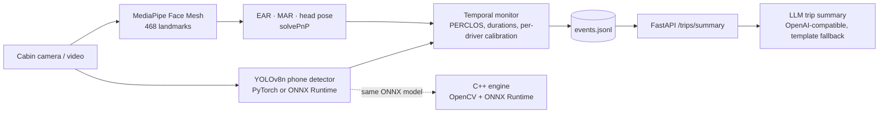

# CabinSense: Real-Time Driver Monitoring System


CabinSense watches the driver through a cabin camera and raises alerts for **drowsiness, microsleep, yawning,
looking away from the road and phone use**, in real time on a CPU. A C++ inference engine runs the same
ONNX model for embedded/edge targets, and an LLM writes a plain-English safety summary after each trip.



## What it detects

| Alert | Signal | Rule (configurable in `MonitorConfig`) |
|---|---|---|
| Drowsiness | PERCLOS: share of time eyes are closed | > 15 % over a rolling 30 s window |
| Microsleep | Continuous eye closure | ≥ 1.5 s |
| Yawning | Mouth aspect ratio (MAR) | MAR > 0.6 for ≥ 1 s |
| Distraction | Head yaw / pitch vs the driver's neutral pose | > 30° yaw or > 25° pitch for ≥ 2 s |
| Phone use | YOLOv8n "cell phone" detections | visible for ≥ 1 s |
| Driver not visible | No face found | ≥ 2 s |

**Per-driver calibration:** during the first 3 s the monitor learns the driver's neutral head pose and
open-eye EAR. Distraction is measured relative to that pose, and "eyes closed" means EAR below 70 % of the
driver's own open-eye value. This removes false alarms from camera mounting angle and naturally narrow eyes
(both seen in testing). Fatigue alerts are held until calibration finishes. Each alert type has a cooldown
so one event does not repeat every frame.

## Quick start

```bash
python -m venv .venv && source .venv/bin/activate        # Windows: .venv\Scripts\activate
pip install -r requirements.txt

python -m cabinsense.run --source 0                       # webcam, live HUD (q to quit)
python -m cabinsense.run --source drive.mp4 --save out.mp4 --no-display
```

Edge path: export once, then run the ONNX model in Python or C++:

```bash
python tools/export_onnx.py                               # models/yolov8n.onnx + models/yolov8n_int8.onnx
python -m cabinsense.run --source 0 --backend onnx --model models/yolov8n.onnx

bash cpp/build.sh                                         # Linux/WSL: OpenCV + ONNX Runtime + CMake
./cpp/build/cabinsense_engine models/yolov8n.onnx 0
```

Trip summary API:

```bash
uvicorn cabinsense.api:app
curl -X POST localhost:8000/trips/summary -H "Content-Type: application/json" \
     -d '{"duration_s": 1800, "events": [{"t": 610, "kind": "yawn", "value": 0.7}]}'
```

Set `CABINSENSE_LLM_BASE_URL`, `CABINSENSE_LLM_API_KEY` and `CABINSENSE_LLM_MODEL` to use any OpenAI-compatible
endpoint (OpenAI, Groq, Gemini, local Ollama). Without them a deterministic template summary is returned, so
the pipeline works offline.

## Performance

Measured with `tools/benchmark.py` on an Intel Core i-series laptop CPU (Coffee Lake, no GPU), 820×1024 input, 40 runs:

| Stage | p50 latency | p95 latency |
|---|---|---|
| Face Mesh + EAR / MAR / head pose | 17.3 ms | 20.3 ms |
| YOLOv8n, PyTorch FP32 | 120.7 ms | 157.4 ms |
| YOLOv8n, ONNX Runtime FP32 | 124.7 ms | 147.9 ms |
| YOLOv8n, ONNX Runtime INT8 (dynamic) | 210.9 ms | 251.6 ms |

- The full pipeline runs at **55–60 FPS** on a face video because the phone detector runs every 3rd frame
  (`--phone-every`) while face analysis runs every frame.
- INT8 dynamic quantization cuts the model from **12.9 MB to 3.5 MB (3.7× smaller)**. It is *slower* on this
  CPU, which lacks VNNI INT8 instructions. It pays off on ARM/NPU edge targets or with static (QDQ) quantization,
  listed under next steps.

## Project layout

```
cabinsense/
  geometry.py     EAR, MAR, head pose (solvePnP + RQ decomposition)
  perception.py   MediaPipe face analysis, YOLO phone detector (PyTorch / ONNX Runtime)
  monitor.py      temporal state machine, calibration, alert cooldowns
  run.py          real-time CLI with HUD, event log and video export
  summary.py      trip statistics + LLM / template summary
  api.py          FastAPI service
cpp/              C++17 engine: OpenCV + ONNX Runtime, letterbox, NMS, phone-use rule
tools/            ONNX export + INT8 quantization, latency benchmark
tests/            unit tests for geometry, monitor rules, summary and API (run in CI)
```

## Next steps

- Fine-tune the detector on in-cabin data (e.g. the DMD dataset) for phone, eating and smoking at cabin angles.
- Static INT8 (QDQ) quantization with calibration images, and benchmarks on ARM (Raspberry Pi / Jetson).
- Android Automotive OS app running the ONNX model on-device.
- Infrared camera support for night driving.

## License

MIT
